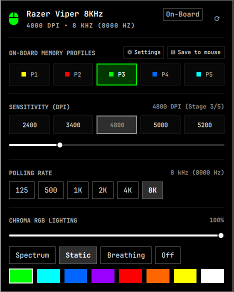
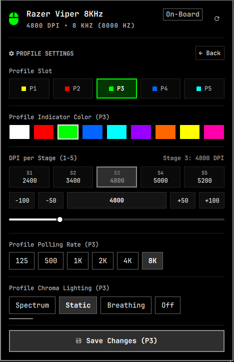

# Oma Razer Control (`oma.razer`)

<div align="center">

[](CHANGELOG.md)
[](https://omarchy.org)
[](LICENSE)
[](https://kernel.org)
[](https://razer.com)

**Native Razer Mouse Control for the Omarchy Desktop Shell**

*On-board profiles, a full Profile Settings editor, 8000 Hz HyperPolling, 5-stage DPI and Chroma RGB, all from your status bar.*

</div>

---

## 🚀 Version 2.0 is here

Version 2.0 is the biggest update to Oma Razer Control so far. You can now edit every on-board profile from the panel, profile switching responds instantly, the physical button under the mouse stays in sync with the panel, and Razer mice beyond the Viper are supported.

### What's new in 2.0

- ⚙️ **Profile Settings editor**: a dedicated settings view for each of the 5 on-board profiles. Edit the indicator color, the DPI of every stage (1–5), the polling rate and the Chroma lighting, then save with a **Save Changes** button that stays pinned to the bottom of the panel.
- ⚡ **Instant profile switching**: profile settings are cached, so the panel shows the new profile immediately while the mouse applies it in the background. An animated indicator on the `P1`–`P5` buttons shows when a switch is in progress.
- 🖱️ **Bottom button sync**: the profile button and LED on the underside of the mouse are now mapped to `P1`–`P5`. Switching or saving a profile in the panel updates the LED color on the mouse, and pressing the physical button updates the panel.
- 🧠 **Multi-model support**: a built-in database of Razer mice (Viper, DeathAdder, Basilisk, Naga, Cobra, Mamba, Orochi) plus automatic detection of 8 kHz polling, transaction ID and profile-button mode for models that aren't listed yet.
- 📏 **Per-device DPI limits**: the DPI sliders and inputs adapt to the maximum DPI of the connected sensor (8,500 up to 35,000 DPI).
- 🎛️ **No accidental changes**: scrolling the panel with the mouse wheel no longer moves the DPI or brightness sliders, and DPI values snap to clean steps of 50.
- ◻️ **Square, theme-native UI**: every button, card, input and swatch follows the Omarchy aesthetic, with square corners.

See the full [CHANGELOG](CHANGELOG.md).

---

## Screenshots

<div align="center">

| Main panel | Profile Settings (new in 2.0) |
| :---: | :---: |
|  |  |
| Profiles, DPI stages, polling rate and Chroma lighting | Per-profile color, stage DPI, polling rate and lighting |

<br/>

**Status bar widget**


</div>

---

## Overview

**Oma Razer Control** adds lightweight Razer mouse management to your Omarchy status bar. It doesn't need a background daemon, a cloud account or an Electron app.

The plugin talks to the mouse's hardware controller directly over Linux `/dev/hidraw`. From the panel you can switch and edit on-board profiles, set polling rates up to **8000 Hz**, adjust DPI stages and change Chroma RGB lighting in real time.

---

## Features

- 󰍽 **Live status bar display**: the current DPI appears next to the mouse icon in your Omarchy bar (for example `󰍽 4800`).
- 💾 **On-board memory profiles (P1–P5)**: switch between the 5 hardware profiles stored in the mouse's flash memory, each with its own indicator color.
- ⚙️ **Profile Settings editor**: edit any profile's indicator color, 5 DPI stages, polling rate and lighting without switching to it first.
- 🖱️ **Two-way bottom button sync**: the panel and the physical profile button under the mouse always agree on the active profile.
- ⚡ **HyperPolling (up to 8000 Hz)**: choose 125, 500, 1000, 2000, 4000 or **8000 Hz** on supported mice.
- 🎯 **5-stage DPI presets and a precision slider**: pick a stage with one click or fine-tune in steps of 50, up to your sensor's maximum.
- 🌈 **Chroma RGB lighting**:
  - Modes: **Static**, **Spectrum Cycling**, **Breathing** and **Off**.
  - **Lighting zones**: on multi-zone mice (for example the Basilisk V3's logo, scroll wheel and underglow) you can drive every zone together or each one separately. Zones are detected from the device; logo-only mice work as before.
  - Brightness slider (0–100%) and a calibrated color palette.
- 🧠 **Multi-model support**: a known-device database plus automatic detection of each mouse's capabilities.
- 🚀 **No daemon overhead**: commands go straight to the hardware as standard 90-byte Razer USB HID feature reports with CRC verification.
- 🎨 **Adaptive theme**: matches your active Omarchy color scheme and typography.
- 🌐 **Bilingual interface**: English by default, with a full Spanish translation (auto-detected from the system locale or set manually).
- 🔌 **Full IPC API**: control every setting from scripts or Hyprland keybindings.

---

## Bottom button and profile mapping

On mice with a profile/stage button on the underside (Viper 8KHz, Viper Mini, Cobra and similar), the LED colors map to the panel profiles like this:

| Panel profile | Bottom LED color |
| :---: | :---: |
| **P1** | 🟨 Yellow |
| **P2** | 🟥 Red |
| **P3** | 🟩 Green |
| **P4** | 🟦 Blue |
| **P5** | 🟦 Cyan |

Mice with a dedicated on-board profile button (Naga Pro, Basilisk V3, DeathAdder V2 Pro and similar) use the native on-board slot switching commands instead. The plugin picks the right mode for each model automatically.

---

## Compatibility

Tested on the **Razer Viper 8KHz** (`PID: 0x0091`). The built-in device database also covers:

| Family | Models |
| --- | --- |
| **Viper** | Viper, Viper Mini, Viper 8KHz, Viper Ultimate, Viper V2 Pro, Viper V3 Pro, Viper V3 HyperSpeed |
| **DeathAdder** | Essential, V2, V2 Pro, V2 Mini, V3, V3 Pro |
| **Basilisk** | V2, Ultimate, V3, V3 Pro |
| **Naga** | Naga Pro, Naga X |
| **Others** | Cobra, Cobra Pro, Mamba Elite, Orochi V2 |

Other Razer mice that use the Razer HID protocol are detected automatically: the plugin probes for 8 kHz polling, the right transaction ID and the profile-button mode. If your model doesn't behave correctly, please [open an issue](https://github.com/gregorylara/omarchyRazerControl/issues) with the output of `./razer_ctl.py status --json`.

---

## Installation

### From the Omarchy Marketplace / CLI
```sh
omarchy plugin add https://github.com/gregorylara/omarchyRazerControl.git --enable
```

### Manual installation (development)
```sh
git clone https://github.com/gregorylara/omarchyRazerControl.git ~/.config/omarchy/plugins/oma.razer
omarchy plugin enable oma.razer --section right
omarchy restart shell
```

---

## One-time hardware access setup (udev)

To let the Omarchy shell talk to `/dev/hidraw*` without `sudo` or password prompts, run:

```sh
cd ~/.config/omarchy/plugins/oma.razer
./setup.sh
```

You can also click the **Enable** button on the permissions banner inside the plugin panel.

This installs `99-razer-omarchy.rules` into `/etc/udev/rules.d/` and grants your active logged-in seat user read/write access to Razer mice.

---

## Shell IPC commands

Control your Razer mouse from terminal shortcuts or window manager keybindings:

```sh
# Interface
omarchy-shell oma.razer open                 # Open the Razer panel
omarchy-shell oma.razer settings             # Open the Profile Settings view (new in 2.0)
omarchy-shell oma.razer close                # Close the panel
omarchy-shell oma.razer toggle               # Toggle open / close
omarchy-shell oma.razer refresh              # Re-query device status

# Hardware settings
omarchy-shell oma.razer dpi 1600             # Set sensor DPI to 1600
omarchy-shell oma.razer stage 3              # Activate DPI stage 3
omarchy-shell oma.razer nextStage            # Cycle to next DPI stage (1 → 2 → ... → 5 → 1)
omarchy-shell oma.razer prevStage            # Cycle to previous DPI stage (5 → 4 → ... → 1 → 5)
omarchy-shell oma.razer stage next           # Alias for nextStage
omarchy-shell oma.razer stage prev           # Alias for prevStage
omarchy-shell oma.razer poll 8000            # Set polling rate to 8000 Hz
omarchy-shell oma.razer profile 2            # Switch to on-board profile P2
omarchy-shell oma.razer nextProfile          # Cycle to next profile (P1 → P2 → ... → P5 → P1)
omarchy-shell oma.razer prevProfile          # Cycle to previous profile (P5 → P4 → ... → P1 → P5)
omarchy-shell oma.razer profile next         # Alias for nextProfile
omarchy-shell oma.razer profile prev         # Alias for prevProfile
omarchy-shell oma.razer brightness 100       # Set LED brightness to 100% (all zones)
omarchy-shell oma.razer effect static        # Lighting: static, spectrum, breathing, off (all zones)
omarchy-shell oma.razer color "#00FF00"      # Apply a hex color to the current effect (all zones)

# Single lighting zone: logo, scroll, underglow, left, right, backlight
omarchy-shell oma.razer zoneBrightness underglow 40
omarchy-shell oma.razer zoneEffect scroll spectrum
omarchy-shell oma.razer zoneColor logo "#FF0000"
```

### Hyprland keybinding example (`~/.config/hypr/bindings.lua`)

To cycle through on-board profiles (`P1`–`P5`) or DPI stages (`1`–`5`) with a keyboard shortcut without colliding with Omarchy's default bindings, add this to `~/.config/hypr/bindings.lua`:

```lua
o.bind("SUPER + CTRL + M", "Razer: Next profile", "omarchy-shell oma.razer nextProfile")
-- Optional: cycle DPI stages within the current profile
-- o.bind("SUPER + ALT + M", "Razer: Next DPI stage", "omarchy-shell oma.razer nextStage")
```

---

## Standalone CLI (`razer_ctl.py`)

The backend script also works on its own, outside the desktop shell:

```sh
./razer_ctl.py status --json                 # Device, capabilities and profile status as JSON
./razer_ctl.py set-dpi 1600                  # Set DPI
./razer_ctl.py set-stage 2                   # Switch DPI stage
./razer_ctl.py set-stage next                # Cycle to next DPI stage (1 → 5 → 1)
./razer_ctl.py set-stage prev                # Cycle to previous DPI stage
./razer_ctl.py set-dpi-stages 800 1600 3200 4800 6400 --active 2   # Set all 5 stage values
./razer_ctl.py set-poll-rate 8000            # Set polling rate in Hz
./razer_ctl.py set-effect static --color "#00FF00"                 # Static green (all zones)
./razer_ctl.py set-effect static --color "#FF0000" --zone underglow
./razer_ctl.py set-brightness 50 --zone logo
./razer_ctl.py profile switch 1              # Switch on-board profile
./razer_ctl.py profile next                  # Cycle to next on-board profile (P1 → P5 → P1)
./razer_ctl.py profile prev                  # Cycle to previous on-board profile
./razer_ctl.py profile save --slot 1         # Save current settings to a slot

# Edit any profile slot (new in 2.0)
./razer_ctl.py profile update --slot 3 \
  --badge-color "#00FF00" \
  --dpi-stages 2400,3400,4800,5000,5200 \
  --active-stage 3 \
  --poll-rate 8000 \
  --effect static --color "#00FF00" --brightness 100
```

Profiles are stored in `~/.local/state/omarchy/razer/profiles.json`.

---

## Configuration (`shell.json`)

Set these options in `~/.config/omarchy/shell.json` under your bar configuration:

```json
{
  "id": "oma.razer",
  "showDpiInBar": true,
  "onlyWhenConnected": false,
  "notifyOnConnect": true,
  "notifyOnProfileSwitch": true,
  "language": "en"
}
```

| Option | Type | Default | Description |
|---|---|---|---|
| `showDpiInBar` | `boolean` | `true` | Show the current DPI next to the mouse icon in the bar |
| `onlyWhenConnected` | `boolean` | `false` | Hide the widget when the mouse is disconnected |
| `notifyOnConnect` | `boolean` | `true` | Send a desktop notification when the mouse is plugged in |
| `notifyOnProfileSwitch` | `boolean` | `true` | Send a desktop notification when switching profiles via keybinding or IPC |
| `language` | `string` | `"en"` | Interface language: `"en"` (default), `"es"`, or `"auto"` (system locale) |

---

## Architecture

- **`Panel.qml`**: Quickshell panel and status bar widget, including the Profile Settings view and the profile cache.
- **`Model.js`**: telemetry parsing, default profiles, badge color mapping and translations.
- **`razer_ctl.py`**: direct HID controller. It includes the device database, capability probing, bottom-button and on-board slot sync, and uses `ioctl(HIDIOCSFEATURE / HIDIOCGFEATURE)` with `fcntl.flock` locking for safe concurrent access.
- **`profiles.json`**: default profile template for new installs.
- **`99-razer-omarchy.rules`**: udev rule for rootless device access.
- **`setup.sh`**: udev installation helper.

---

## Contributors

Thanks to everyone who has contributed, including multi-zone lighting support ([@headband42](https://github.com/headband42)) and async HID response, battery and wired-node fixes ([@alexwest1981](https://github.com/alexwest1981)).

---

## License

MIT License © 2026 [Gregory Lara](https://github.com/gregorylara). See [LICENSE](LICENSE) for details.
